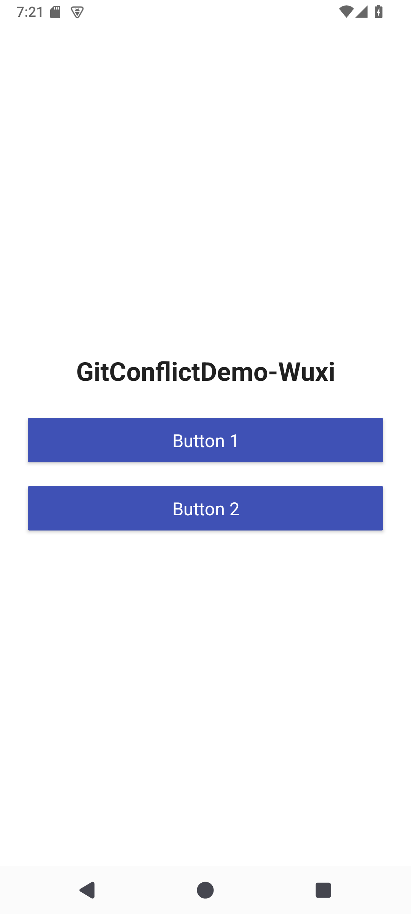
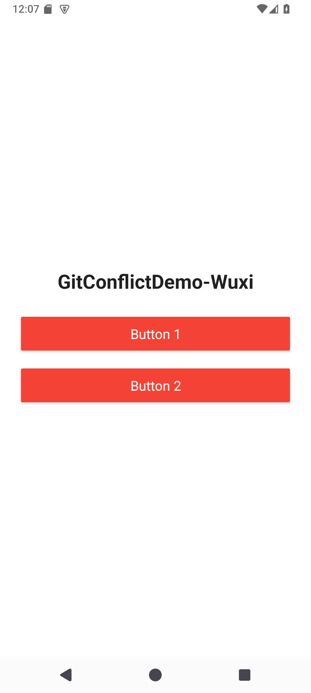
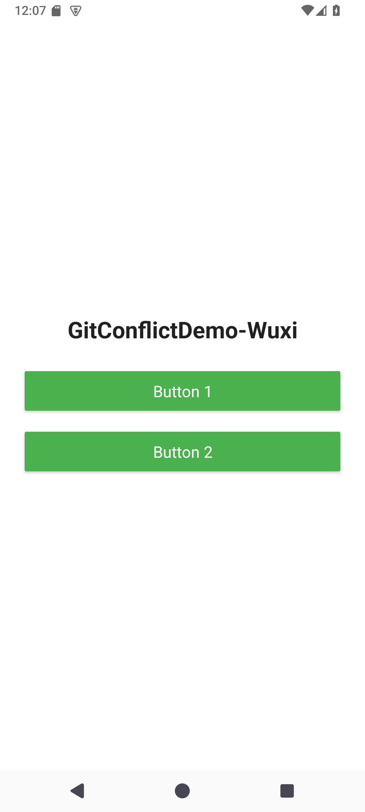

# GitConflictDemo-Wuxi

Practical 4 group project: two developers change the same Android XML attributes, inspect the resulting merge conflict, and keep the agreed final implementation.

| Role | GitHub account | Feature |
| --- | --- | --- |
| Student 1 (20243007027) | [gss897152-pixel](https://github.com/gss897152-pixel) | Red buttons |
| Student 2 | [kyousuke146](https://github.com/kyousuke146) | Green buttons |

## Application

The initial application has two blue buttons (`#3F51B5`). The red branch changes both to `#F44336`, and the green branch changes the same two attributes to `#4CAF50`.

The final implementation keeps green, corresponding to resolution Option B in the practical. Each button displays a short message when tapped.

| Initial version | Student 1 red version | Final green version |
| --- | --- | --- |
|  |  |  |

## Run

Open the project folder in Android Studio with support for Android Gradle Plugin 9.4. Install Android SDK 37, wait for Gradle sync, select `app`, and run on an emulator.

The project uses AGP 9.4.1, Gradle 9.6.0 and a minimum Android API level of 24.

To build on Windows:

```powershell
.\gradlew.bat :app:assembleDebug
```

## Commits and pull requests

| Step | Commit | Author account | Result |
| --- | --- | --- | --- |
| Initial application | [`d3a3b51`](https://github.com/gss897152-pixel/GitConflictDemo-Wuxi/commit/d3a3b51baacf3958dc23d4f5f4719824e686fedf) | gss897152-pixel | Two blue buttons |
| Red feature | [`aba7c63`](https://github.com/gss897152-pixel/GitConflictDemo-Wuxi/commit/aba7c63a3aec3b1caf1ba92e509e1988a46c2774) | gss897152-pixel | Both buttons red |
| Green feature | [`0357bee`](https://github.com/gss897152-pixel/GitConflictDemo-Wuxi/commit/0357bee12f105814432a91a6f3a1f196b3d624cc) | kyousuke146 | Both buttons green |
| Resolve button color merge conflict | [`934f820`](https://github.com/gss897152-pixel/GitConflictDemo-Wuxi/commit/934f820ced129a70882ad13297e23ae156454725) | kyousuke146 | Keep the green implementation |
| Merge green feature into main | [`4ffcf4f`](https://github.com/gss897152-pixel/GitConflictDemo-Wuxi/commit/4ffcf4f62e0afc2233928c2b85690bdbd6543c64) | kyousuke146 | Resolved application on main |

Both feature commits start from the same initial commit, `d3a3b51`.

1. [Red PR #1](https://github.com/gss897152-pixel/GitConflictDemo-Wuxi/pull/1) was merged first, at 21:09 on 20 October 2026 (UTC+8).
2. [Green PR #2](https://github.com/gss897152-pixel/GitConflictDemo-Wuxi/pull/2) was opened after the red merge. The green feature still changed the original blue attributes, so the two implementations conflicted.
3. Resolution commit `934f820` combined the green branch with the red main history, keeping green.
4. PR #2 was merged at 21:28. Both feature branches remain available.

The feature commits belong to the accounts listed above. The two pull requests were reviewed and merged in the required order; the follow-up verification and repository documentation were prepared through Student 1's account.

## Conflict and verification evidence

The recorded red and green versions reproduce a content conflict in both `android:backgroundTint` lines. See the [conflict reproduction](docs/evidence/conflict-reproduction.txt) and [verification notes](docs/verification.md).

The red and final green versions were built and run on a Medium Phone emulator with Android API 35 during verification on 21 October 2026. The screenshots show those recorded versions. The final XML parses correctly and contains no conflict markers.

Initial button interaction screenshots are also available: [Button 1](docs/screenshots/button-1-clicked.png) and [Button 2](docs/screenshots/button-2-clicked.png).
